# library_project

# 📚 مكتبتي | My Library App

تطبيق متكامل لإدارة المكتبة الشخصية وتتبع القراءة، مصمم بهوية بصرية كلاسيكية دافئة تجمع بين فخامة الخط العربي وسهولة الاستخدام.

A comprehensive personal library and reading tracker mobile application built with Flutter and Firebase, featuring a warm classic aesthetic.

---

## ✨ المميزات الرئيسية | Key Features

* **📖 إدارة المكتبة الشخصية:** إضافة الكتب مع تفاصيلها (العنوان، المؤلف، صورة الغلاف، وملف القراءة PDF).
* **🔍 بحث فوري وذكي:** تصفية الكتب ديناميكياً في نفس الشاشة بمجرد كتابة اسم الكتاب أو المؤلف.
* **⏱️ مؤقت وتتبع القراءة:** حساب مدة جلسات القراءة وحفظ الوقت التراكمي لكل كتاب وتحويله تلقائياً إلى ساعات ودقائق.
* **📊 إحصائيات التقدم:** عرض الكتب التي تُقرأ حالياً والكتب المنهية بنجاح مع تقييم النجوم.
* **📜 خزانة الاقتباسات:** تنظيم الاقتباسات داخل مجلدات مخصصة وعرضها بتصميم ورقي كلاسيكي.
* **🔐 حسابات آمنة:** تسجيل الدخول عبر البريد الإلكتروني أو حساب جوجل (Google Sign-In) ومزامنة البيانات لحظياً عبر السحابة.

---

## 🛠️ التقنيات والخدمات السحابية | Tech Stack & Cloud Services

* **Framework:** Flutter (Dart)
* **Authentication:** Firebase Authentication (Email & Google Sign-In)
* **Database:** Cloud Firestore (لتخزين بيانات الكتب، إحصائيات القراءة، ومجلدات الاقتباسات)
* **Media Storage:** Cloudinary (لرفع وتخزين أغلفة الكتب وملفات القراءة PDF سحابياً)
* **Architecture:** Clean separation of UI and Cloud service classes

## 📱 لقطات من التطبيق | App Screenshots

| شاشات الدخول والبروفايل | | |
| :---: | :---: | :---: |
| 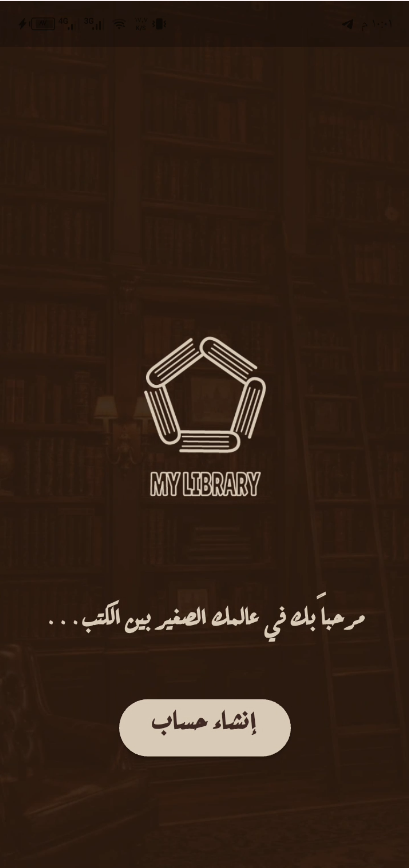 | 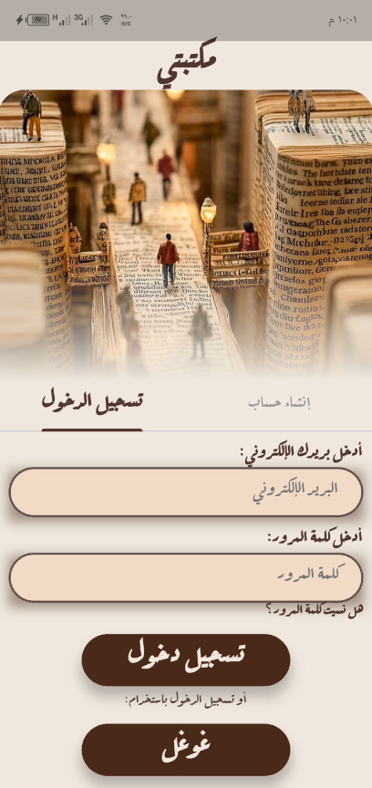 | 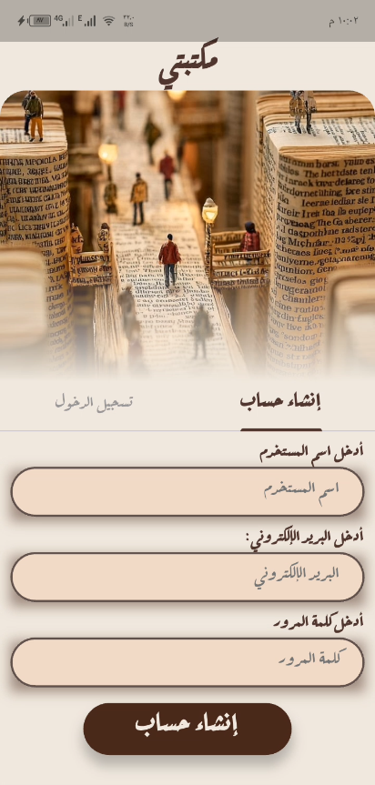 |

| الشاشة الرئيسية والبحث | | |
| :---: | :---: | :---: |
| 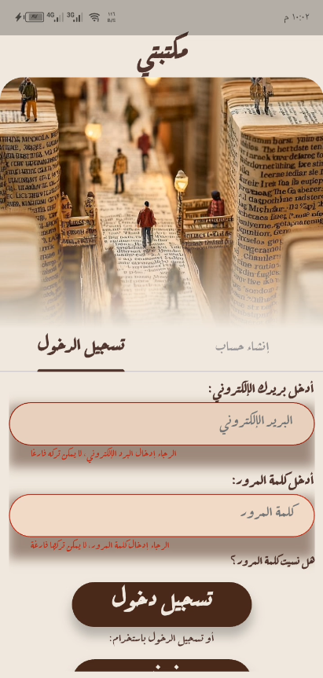 | 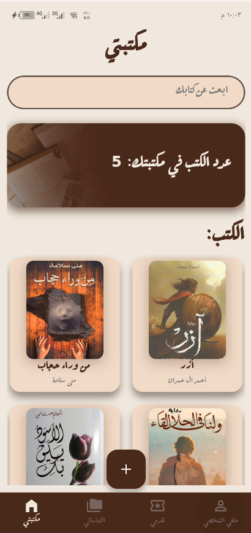 | 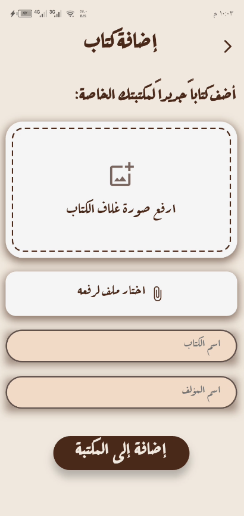 |

| صفحات قراءة الكتب وتتبع الوقت | | |
| :---: | :---: | :---: |
| 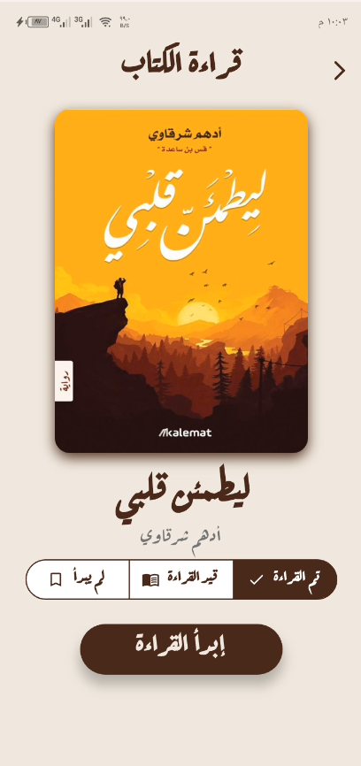 | 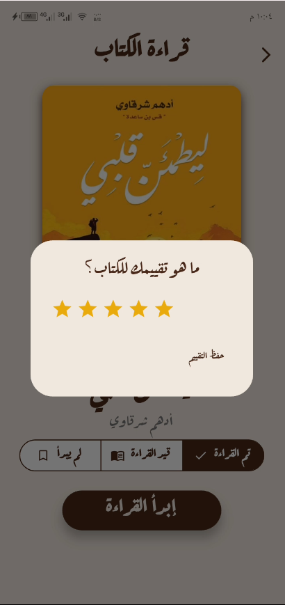 | 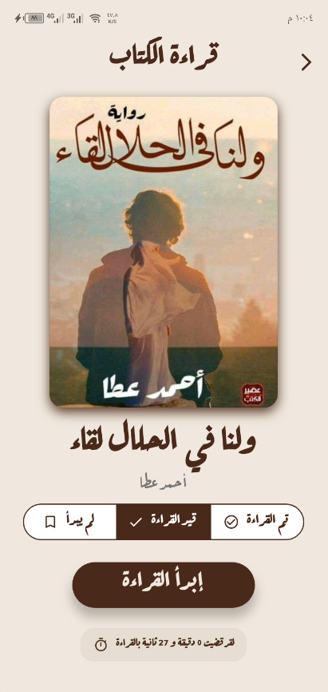 |

| قسم المجلدات والاقتباسات | | |
| :---: | :---: | :---: |
| 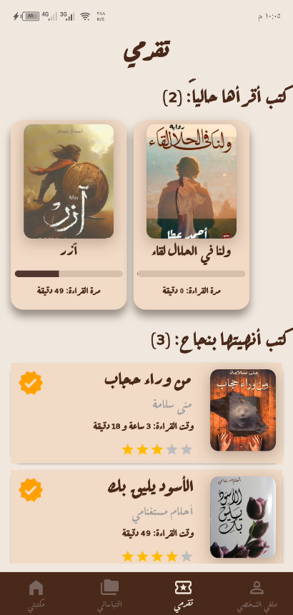 | 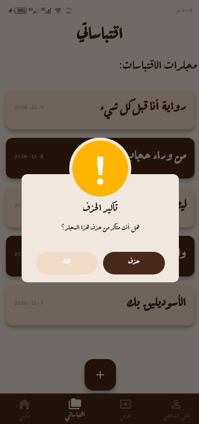 | 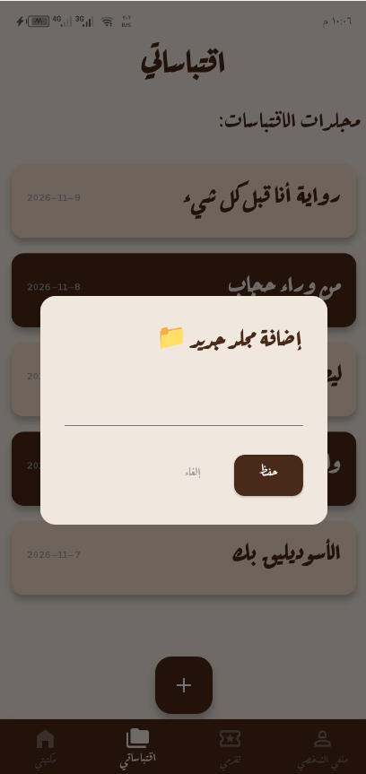 |

| تفاصيل وعرض الاقتباسات الفخمة | | |
| :---: | :---: | :---: |
| 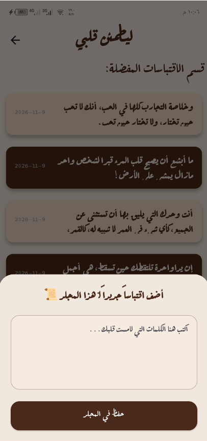 | 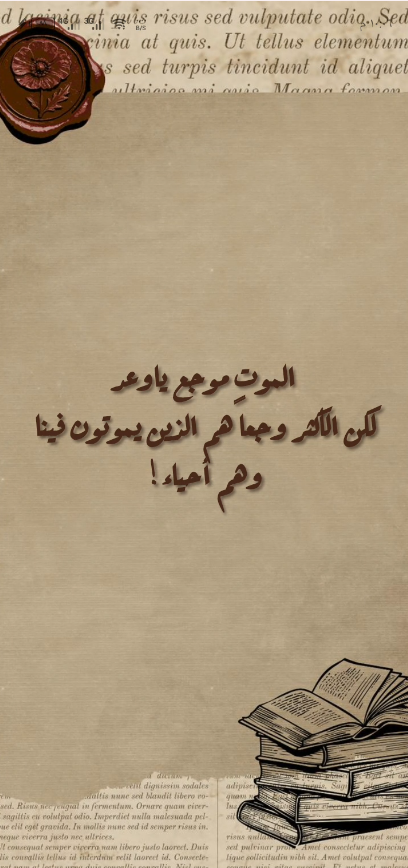 | 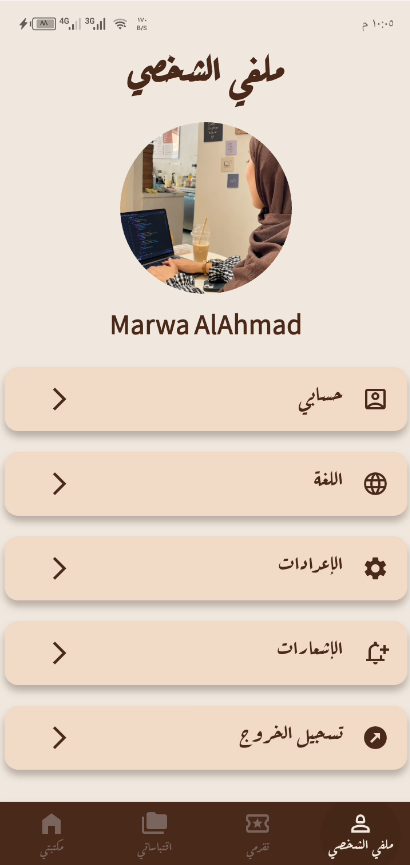 |
